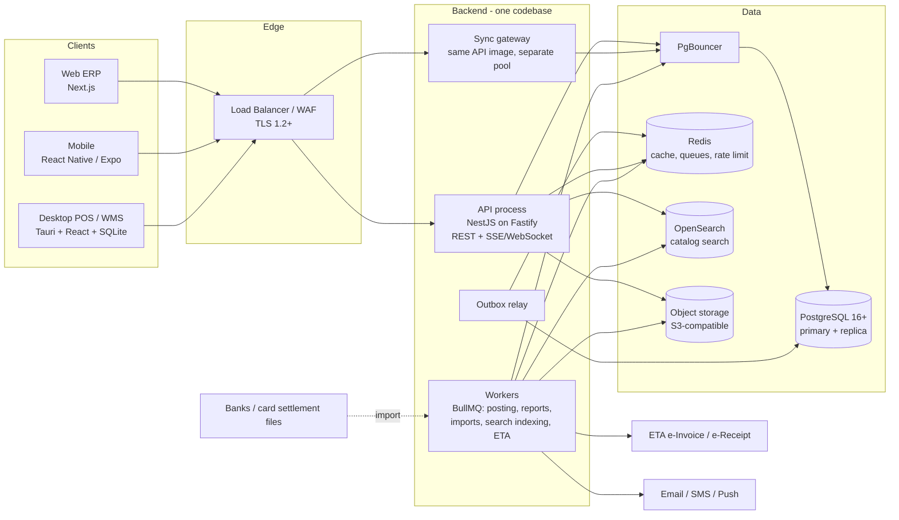
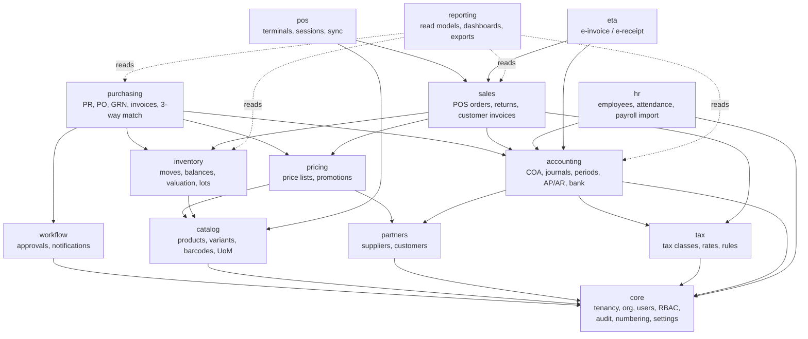

# System Architecture

**Version:** 0.1 — Draft for review · **Date:** 2026-11-05

Contents
1. Architectural style & key decisions (with trade-offs)
2. System context & containers
3. Technology stack
4. Module dependency map
5. Multi-company / multi-branch architecture
6. POS offline synchronization design
7. API architecture
8. Eventing, jobs & real-time
9. Performance & scalability strategy
10. Repository layout
11. Architecture Decision Records index

---

## 1. Architectural Style & Key Decisions

### 1.1 Modular monolith (not microservices) — **Decision ADR-001**
One deployable backend (`api`) + separate worker processes from the **same codebase**, organized as strictly bounded modules with explicit public interfaces. Modules communicate in-process via service interfaces and domain events (outbox).

| Option | Pros | Cons | Verdict |
|---|---|---|---|
| Microservices | Independent scaling/deploys | Distributed transactions across inventory↔accounting (exactly where ERP needs ACID), ops cost, eventual consistency bugs in money | ❌ for v1 |
| **Modular monolith** | ACID across stock move + valuation + journal in one transaction; simpler ops; refactorable to services later | Discipline required to keep boundaries | ✅ |
| Classic monolith | Fastest start | Turns into big ball of mud at this scope | ❌ |

Boundary enforcement: `dependency-cruiser` / ESLint boundaries rules in CI; each module owns its tables (prefix), no cross-module table writes; reads across modules only via module query API or read-models.

### 1.2 Same-transaction financial integrity — **ADR-002**
A stock move that has a financial effect writes, **in the same DB transaction**: the move, the balance update, the valuation layer, and an outbox event. The GL journal is produced by the posting engine from that event **in a separate transaction**, idempotently keyed on the source event.
- *Trade-off:* GL is a few seconds behind operations (eventually consistent within the same DB), but the operational transaction stays fast and the posting engine can be replayed/re-run per rule version. A reconciliation job proves `inventory valuation (subledger) == inventory GL account balance` daily.
- *Alternative rejected:* posting journals synchronously inside each operation — couples every operational write path to posting rule complexity and locks GL rows on hot paths (POS sync).

### 1.3 Shared domain logic across Web, Desktop, Mobile — **ADR-003**
Pricing, promotion, tax calculation, rounding, UoM conversion and validation schemas live in a pure TypeScript package `@rc/domain` (no I/O). It runs:
- on the server (authoritative),
- inside the POS (offline price/promo/tax calculation),
- in web/mobile for instant UI feedback.

The server **recomputes** totals on every synced POS transaction and records any delta as a `pricing_discrepancy` (never silently "fixes" a receipt the customer already paid).

### 1.4 IDs: UUIDv7 everywhere — **ADR-004**
Client-generatable (offline POS, mobile counts), globally unique across devices, time-ordered (good B-tree locality, unlike UUIDv4).
- *Trade-off:* 16 bytes vs 8 for bigint; accepted. Human-facing numbers (receipt no., PO no.) are separate sequences.

### 1.5 Money & quantity types — **ADR-005**
- Amounts: `NUMERIC(19,4)` in DB, decimal library (`decimal.js`/`big.js`) in TS — **never JS `number` for money**.
- Quantities: `NUMERIC(19,6)` (weighted goods, UoM conversions).
- Unit cost: `NUMERIC(19,6)`.
- Currency rounding applied at document total level using a documented rounding rule (per line tax then sum vs. on total) — **configurable, must match ETA rules**.

### 1.6 Search: PostgreSQL for exact, OpenSearch for fuzzy — **ADR-006**
- Barcode/SKU exact lookup → PostgreSQL unique B-tree indexes (sub-ms, always consistent).
- Name search, facets, typo tolerance, Arabic normalization → OpenSearch, fed from catalog outbox events (CDC lag target < 5 s).
- Fallback: `pg_trgm` index on normalized names if OpenSearch is unavailable (degraded but functional).
- *Trade-off:* extra infrastructure; justified by 1M SKUs × bilingual fuzzy search with p95 < 300 ms.

---

## 2. System Context & Containers



**Why a separate sync pool:** POS sync bursts (e.g., 300 terminals reconnecting after an ISP outage) must not starve back-office users. Same image, separate deployment with its own concurrency limits and DB pool.

---

## 3. Technology Stack

| Layer | Choice | Rationale / trade-off |
|---|---|---|
| Language | TypeScript (strict) end-to-end; Rust only inside Tauri core | One language for shared domain rules |
| Backend framework | NestJS (Fastify adapter) | Module system maps to bounded contexts; DI; mature. Alternative: plain Fastify (less structure) |
| DB access | Kysely (type-safe SQL builder) + hand-written SQL migrations | Full control over partitioning, locking (`FOR UPDATE SKIP LOCKED`), CTEs. Prisma rejected: weak partitioning/locking control |
| Migrations | `graphile-migrate` or `dbmate` (plain SQL, forward + down where feasible) | Reviewable SQL, expand/contract pattern |
| Validation | Zod schemas in `@rc/domain`, shared by API + clients; OpenAPI generated from them | Single source of truth |
| DB | PostgreSQL 16+ with `pg_partman`, `pg_trgm`, `pg_stat_statements` | Partitioning, trigram fallback search |
| Pooling | PgBouncer (transaction mode) | Connection fan-out from many workers |
| Cache/queue | Redis 7 + BullMQ | Jobs with retries, rate limiting, scheduled jobs |
| Search | OpenSearch 2.x with Arabic analyzer + custom normalizer | See ADR-006 |
| Object storage | S3-compatible (AWS S3 / MinIO on-prem) | Images, documents, exports |
| Web | Next.js (App Router) + React + TanStack Query + TanStack Table/Virtual + Radix UI primitives + Tailwind with design tokens | Virtualized grids for huge datasets; accessible primitives |
| Desktop | Tauri 2 (Rust core) + React UI; SQLite via `rusqlite` + SQLCipher | Small footprint, native hardware access, encrypted local DB |
| Mobile | React Native (Expo, dev-client) + expo-sqlite + VisionCamera barcode | Offline counts, camera scanning |
| Auth | Built-in auth module: Argon2id, TOTP MFA (WebAuthn S), short-lived JWT access + rotating refresh; device certificates/keys for POS | OIDC/SSO adapter later |
| Observability | OpenTelemetry → Grafana/Tempo/Loki/Prometheus (or vendor) | Traces across sync & posting |
| Testing | Vitest, Testcontainers (real Postgres), Playwright, k6 | See TESTING.md |
| CI/CD | GitHub Actions, Docker images, Helm or Compose | See DEPLOYMENT.md |

---

## 4. Module Dependency Map

Arrows point from a module to what it **depends on** (calls or reads). Events flow the other way and do not create compile-time dependencies.



**Key rule:** `inventory` does **not** depend on `accounting`. Inventory emits `StockValued` events; accounting's posting engine subscribes. This keeps inventory testable alone and allows the posting rules to evolve without touching stock code.

### Build order implied by the map
`core → catalog/partners/tax → inventory → accounting (+posting engine) → pricing → purchasing → sales → pos (+sync) → reporting → workflow UI/mobile → hr → eta`

---

## 5. Multi-Company / Multi-Branch Architecture

### 5.1 Hierarchy
```
Tenant (deployment/customer group)
 └─ Company (legal entity: tax ID, COA, fiscal calendar, base currency, costing method)
     └─ Branch (store / DC; timezone, address, ETA branch code, default price list)
         ├─ Warehouse (sales floor, back store, DC)  ── Location tree (zone/aisle/bin; types below)
         ├─ POS Terminal (registered device)
         └─ Cost Center (default for branch; more can exist)
```
Location types: `internal`, `transit`, `quarantine`, `scrap`, and virtual `supplier`, `customer`, `inventory_loss`, `production` (future). Virtual locations make every move balanced (qty out of one location = qty into another).

### 5.2 Data isolation — three layers
1. **Request scope resolution (API):** every authenticated request carries a resolved `ActorContext { tenantId, userId, allowedCompanyIds, allowedBranchIds, allowedWarehouseIds, permissions }`. Repository methods require it; queries are built with mandatory scope predicates (lint rule forbids repository calls without context).
2. **PostgreSQL Row-Level Security (defense in depth):** on all tenant/company-scoped tables, policy `company_id = ANY(current_setting('rc.company_ids')::uuid[])` (+ branch policies on branch-scoped tables). The API sets `SET LOCAL rc.*` at transaction start. Application role is **not** table owner and cannot bypass RLS. Reporting/maintenance roles are separate and audited.
3. **Composite foreign keys including `company_id`** (e.g. `(company_id, branch_id) → branches(company_id, id)`) so a record cannot reference a branch of another company even through a bug.

*Trade-off:* RLS adds a small planning cost and complicates bulk jobs; mitigated by indexing scope columns first in composite indexes and by running bulk jobs per company.

### 5.3 Central catalog, branch-specific everything else
| Concern | Entity | Grain |
|---|---|---|
| What the product is | `product`, `product_variant`, `barcode` | Global (tenant) |
| Where it's sold | `branch_assortment` | variant × branch |
| What it costs to buy | `supplier_product` | variant × supplier (× company) |
| What it sells for | `price_list_item` | variant × price list (scoped to company/branch/group) × validity |
| How much exists | `stock_quant` | variant × location × lot × owner |
| What it's worth | `valuation_layer` / `product_cost` | variant × company |
| Promotions | `promotion` + scopes | promotion × branch/group × time |

### 5.4 Consolidation & profitability
- Branch P&L: every journal line carries `branch_id` and `cost_center_id`; branch P&L = GL filtered by dimension.
- Shared costs (HQ rent, central marketing): allocation rules (by sales %, area, headcount) generate allocation journals at period close.
- Group consolidation: sum of company trial balances (same currency v1) minus intercompany elimination entries (accounts flagged `intercompany` + partner company).

---

## 6. POS Offline Synchronization Design

### 6.1 Principles
1. **The terminal's local SQLite journal is the system of record for a sale until the server acknowledges it.**
2. A sale is a **fact** — once the customer paid, the server must accept it (possibly with exceptions flagged), never reject and discard.
3. **Exactly-once effect** via client-generated UUIDv7 + server idempotency registry.
4. **Master data flows down, transactions flow up.** No bidirectional merge of the same record type.

### 6.2 Local architecture (Tauri)
```
┌──────────────── Tauri app ────────────────┐
│ React UI (cart, payment, shift screens)   │
│   │ invoke()                              │
│ ┌─▼────────────────────────────────────┐  │
│ │ Rust core                            │  │
│ │  • Local store (SQLite + SQLCipher,  │  │
│ │    WAL, synchronous=FULL)            │  │
│ │  • Transaction journal (append-only) │  │
│ │  • Sync engine (push/pull, backoff)  │  │
│ │  • Hardware: ESC/POS printer, drawer,│  │
│ │    serial/HID scanner, scale, display│  │
│ │  • Device identity (key in OS        │  │
│ │    keystore / TPM where available)   │  │
│ └──────────────────────────────────────┘  │
└───────────────────────────────────────────┘
```
Domain calculations (`@rc/domain`) run in the UI layer; the Rust core persists the **final, already-calculated** transaction atomically, then prints.

**Commit order on "Pay":** (1) write `pos_txn` + lines + payments + `journal_entry(state=pending_sync)` in **one SQLite transaction** with fsync → (2) open drawer / print receipt → (3) enqueue for sync. If power fails after (1), recovery replays print as "reprint"; if it fails before (1), no sale exists (customer hasn't received a receipt).

### 6.3 Local data
| Table | Direction | Notes |
|---|---|---|
| `products_local`, `barcodes_local`, `prices_local`, `promotions_local`, `tax_rules_local` | ↓ pull | Only branch assortment; FTS5 index on normalized AR/EN names |
| `customers_local` | ↓ pull (recent/active) + ↑ new | New customers created offline pushed up; server dedupes by phone |
| `users_local` | ↓ pull | Cashier PIN hashes (Argon2), permissions snapshot |
| `pos_txn`, `pos_txn_line`, `pos_payment` | ↑ push | Immutable after commit |
| `shift_session`, `cash_movement` | ↑ push | Open/close, float, cash in/out, counts |
| `sync_outbox` | local | `seq`, `entity`, `id`, `payload_hash`, `status`, `attempts`, `last_error` |
| `sync_state` | local | Pull cursors per stream, last success times |

### 6.4 Push protocol (transactions up)
```
POST /api/v1/sync/push
Headers: Authorization: Device <signed token>, Idempotency-Key: <batch uuid>
Body: { deviceId, batchId, items: [ {type:"pos_txn", id:<uuidv7>, seq, hash, payload}, ... ] }  (≤ 200 items)

Server, per item, in its own DB transaction:
  1. INSERT INTO sync_inbox(client_id, device_id, type, payload_hash, received_at)
     ON CONFLICT (client_id) DO NOTHING
  2. if conflict → compare payload_hash:
        same  → status "duplicate_ack" (already applied — safe)
        diff  → status "conflict_hash_mismatch" → quarantine + alert (never apply twice)
  3. else apply: create sales order, stock moves (sale), payments, session links, outbox events
  4. mark inbox row applied
Response: per-item { id, status: applied|duplicate_ack|rejected_quarantined, serverRef, exceptions[] }
Client marks items acked only for applied / duplicate_ack.
```
- **Why a separate non-partitioned `sync_inbox` table:** PostgreSQL unique constraints on partitioned tables must include the partition key; `pos_orders` is partitioned by business date, so global uniqueness of `client_id` is enforced in `sync_inbox` (UUID PK, ~100 bytes/row; archived after 24 months while `pos_orders.client_id` keeps a per-partition unique index).
- **Ordering:** items applied in `seq` order per device; a gap stops the batch at the gap (client resends). Shift open must be applied before its sales; close after.
- **Retry:** exponential backoff with jitter (1 s → 5 min cap); unlimited retries; items never deleted locally until acked + retention.
- **Poison items:** after server-side validation failure (e.g., unknown product id), the item is stored server-side as `quarantined` with full payload → visible in Sync Exceptions screen for resolution → **still counted in Z-report and cash reconciliation**. Nothing is discarded.

### 6.5 Pull protocol (master data down)
- Change feed per stream (`catalog`, `prices`, `promotions`, `users`, `tax`, `settings`) backed by a `change_log` table (monotonic `bigint` version per tenant written by triggers/outbox).
- `GET /api/v1/sync/pull?stream=prices&since=<version>&branchId=…&limit=5000` → `{ items, nextVersion, hasMore }`.
- Initial provisioning: server builds a **compressed SQLite snapshot** of the branch assortment as a background job; terminal downloads from object storage (signed URL), verifies checksum, then pulls deltas since snapshot version.
- Price/promo records are **effective-dated**, pushed ahead of time, so a scheduled midnight price change works offline.

### 6.6 Conflict & policy matrix (offline)
| Area | Offline policy (proposed default — D11–D13) | Server on sync |
|---|---|---|
| Prices | Use local effective price at sale time; store `price_list_item_id` + version on each line | Recompute; delta → `pricing_discrepancy` report, sale stands |
| Promotions | Auto-apply local promotions; coupon single-use codes **not** redeemable offline | Recompute; flag deltas |
| Manual discounts | Role limits enforced locally from permission snapshot; supervisor override by local PIN | Audit record retained |
| Stock | Not blocking offline (local stock is an estimate) | If balance goes negative → `negative_stock_exception` for inventory review; serial/lot-controlled items: serial validated on sync, duplicates → exception |
| Cash | Always allowed | — |
| Card (standalone) | Allowed, terminal ref + last 4 + approval code captured | Matched later to settlement file |
| Vouchers / gift cards / store credit | Redemption **blocked** offline (double-spend risk) | — |
| Customer credit (B2B) | **Blocked** offline | — |
| Returns | Only against receipts present locally (same terminal/branch), within policy | Linked to original via id |
| New customer | Allowed (phone key) | Dedup by normalized phone → merge |
| Max offline | 72 h default → then sales blocked with clear message | Alert to IT/branch manager after 15 min offline |
| Accounting period | Sale keeps its real business date | If period hard-locked → posted to first open date with `late_posting` flag + controller notification (needs D-approval) |

### 6.7 Device security
- Device registration: admin generates one-time enrollment code → device creates key pair (private key in Windows CNG/TPM where available) → server issues device certificate bound to terminal & branch.
- Every push batch is signed; server verifies signature and that device is active.
- SQLCipher key derived from device secret in OS keystore; stolen disk alone is not readable.
- Remote revoke: revoked device can't sync; local app locks on next start after receiving revocation (or after max offline window).

### 6.8 Recovery
- On start: SQLite integrity check, replay `pending_print`, reconcile `sync_outbox` vs journal (any committed txn without outbox row gets one — invariant check).
- Hardware replacement: new device can **not** import another device's DB by default; an "evacuation" tool uploads an un-synced DB from a dead terminal via authorized admin flow (signed with original device key if recoverable; otherwise supervised manual import with audit).

### 6.9 Monitoring
Sync dashboard: per terminal last-seen, queue depth, oldest un-synced txn age, error rates, quarantined items; alerts on queue age > 15 min online, > 4 h any.

---

## 7. API Architecture
Full conventions in [API_DOCUMENTATION.md](API_DOCUMENTATION.md). Summary:
- **REST + JSON, OpenAPI 3.1** generated from Zod schemas; typed clients generated for web/desktop/mobile.
- Versioning: `/api/v1`; additive changes only within a version.
- Resource endpoints for CRUD-like data; **command endpoints** for state transitions (`POST /purchase-orders/{id}:approve`), because ERP workflows are state machines, not field edits.
- `Idempotency-Key` header **required** on every non-GET request from all clients.
- Optimistic concurrency: `version` column, `If-Match` header; `412` on conflict.
- Cursor (keyset) pagination; no `OFFSET` on large tables; counts are approximate unless requested.
- Errors: RFC 9457 `application/problem+json` with stable `code` and localized `title`.
- Real-time: Server-Sent Events for dashboards/notifications; WebSocket only where bidirectional is needed (none in v1).
- Rejected: GraphQL (harder to secure field-level per scope, N+1 risk on huge datasets, caching complexity) — may add a read-only GraphQL for reporting later.

---

## 8. Eventing, Jobs & Real-time
- **Transactional outbox:** modules insert into `outbox_event` in the same transaction as the state change. Relay (polling with `FOR UPDATE SKIP LOCKED`, or logical replication later) publishes to BullMQ queues. Consumers are idempotent (`processed_event` table keyed by `(consumer, event_id)`).
- Core events: `ProductChanged`, `PriceChanged`, `StockMoved`, `StockValued`, `PosTransactionSynced`, `GoodsReceived`, `SupplierInvoicePosted`, `PaymentRecorded`, `PeriodClosed`, `ApprovalRequested/Decided`.
- Consumers: posting engine, search indexer, reporting aggregators, notifications, ETA submitter, POS change-log writer.
- Jobs: imports/exports, bulk updates, report generation, snapshot building, replenishment calc, nightly reconciliations, partition maintenance.

---

## 9. Performance & Scalability Strategy

### 9.1 Data volume model (sizing assumptions for 100 branches, 3 years)
| Table | Est. rows | Strategy |
|---|---|---|
| product_variant | 1–1.5 M | Plain table, B-tree on SKU, trigram on normalized name (fallback) |
| barcode | 3 M | Unique partial index on active barcodes |
| branch_assortment | 1M × 100 × ~10% avg ≈ 10–20 M | PK (branch_id, variant_id) |
| price_list_item | 10–30 M | Index (price_list_id, variant_id, valid_from DESC) |
| stock_quant | 20–50 M | PK (location_id, variant_id, lot_id, owner_id); updated with row locks |
| stock_move | 500 M+ | **Range-partitioned monthly** by `moved_at`, BRIN on time, B-tree on (variant_id, moved_at) per partition |
| pos_order / line / payment | 300 M / 1.5 B | **Monthly partitions by business_date** |
| journal_line | 1 B+ (with shift-level POS posting much less) | **Monthly partitions by posting_date** |
| audit_log | Billions | Monthly partitions, archived to object storage after 24 months |

### 9.2 Techniques
- **Never load full datasets:** keyset pagination, server-side filter/sort, virtualized grids, streaming exports (`COPY … TO STDOUT` → S3 multipart).
- **Hot-path writes:** POS sync applies each receipt in a short transaction; stock_quant updates ordered by (location, variant) to avoid deadlocks.
- **Pre-aggregated read models** for dashboards: `sales_daily_by_branch_variant`, `sales_hourly_by_branch`, `stock_snapshot_daily`; updated incrementally by event consumers, not by heavy queries. Materialized views only for small, periodically refreshed sets (e.g., category KPIs).
- **Formal statements** read GL `account_balance_period` (per company/account/branch/period running totals maintained at posting) → trial balance in milliseconds instead of scanning journal lines.
- **Read replica** for reporting/exports once primary CPU > 60% sustained; reporting queries tagged and routed.
- **Caching:** Redis for permission snapshots, settings, price resolution per (branch, variant) with event-driven invalidation; never cache balances used for validation.
- **Connection pooling:** PgBouncer transaction mode; per-process pools sized from load tests.
- **Query governance:** `pg_stat_statements` budget review in CI perf suite; `statement_timeout` per role (API 5 s, reports 120 s).
- **Partition maintenance:** `pg_partman` creates future partitions; old partitions detached → archived.

### 9.3 Scale-out path (when measured, not before)
1. Vertical PG + replica → 2. split sync gateway & workers horizontally (stateless) → 3. move reporting to a columnar store (ClickHouse) via CDC if read models aren't enough → 4. extract high-churn modules (sync, search indexing) into services if team/deploy cadence requires.

---

## 10. Repository Layout (pnpm + Turborepo)
```
retail-erp/
├─ apps/
│  ├─ api/            NestJS: HTTP API + sync gateway (role by env)
│  ├─ worker/         BullMQ workers, outbox relay, schedulers
│  ├─ web/            Next.js back-office
│  ├─ pos-desktop/    Tauri (src-tauri Rust core + React UI)
│  └─ mobile/         Expo React Native
├─ packages/
│  ├─ domain/         Pure TS: money, tax, pricing, promotions, UoM, zod schemas
│  ├─ api-client/     Generated typed client from OpenAPI
│  ├─ ui/             Design system (tokens, components, RTL)
│  ├─ i18n/           ar/en message catalogs
│  └─ config/         eslint, tsconfig, boundaries rules
├─ db/
│  ├─ migrations/     SQL migrations (expand/contract)
│  └─ seeds/          Egyptian COA template, UoM, tax defaults
├─ tools/
│  ├─ datagen/        Synthetic data generator (1M SKUs, 2y sales)
│  └─ loadtest/       k6 scenarios
└─ docs/
```

---

## 11. ADR Index
| ADR | Decision | Status |
|---|---|---|
| 001 | Modular monolith | Proposed |
| 002 | Inventory→GL via outbox, idempotent posting engine | Proposed |
| 003 | Shared TS domain package across all clients | Proposed |
| 004 | UUIDv7 identifiers | Proposed |
| 005 | NUMERIC money, decimal libraries | Proposed |
| 006 | Postgres exact + OpenSearch fuzzy search | Proposed |
| 007 | RLS as defense-in-depth for company/branch isolation | Proposed |
| 008 | POS GL posting summarized per shift session (D5) | Needs business approval |
| 009 | Weighted average costing default, company level (D2) | Needs business approval |
| 010 | Tauri over Electron for POS | Proposed (risk: Rust skills) |

---

## 12. Implementation decisions (v0.2, 2026-11-06)
| Draft decision | Built as | Why |
|---|---|---|
| NestJS | **Fastify** + small `route()` helper (auth, scope, Zod validation, idempotency, RLS transaction) | Less boilerplate; module boundaries kept by folders |
| Kysely | **`pg` with hand-written SQL** | Full control of locking, partitions, `json_populate_recordset` bulk writes |
| BullMQ | **PostgreSQL outbox** claimed with `FOR UPDATE SKIP LOCKED` (`outbox_claim()`), N worker replicas | One less moving part; exactly-once via `core_processed_event` + `acc_posting_registry` |
| OpenSearch | **`pg_trgm` GIN on Arabic-normalized names** + SECURITY DEFINER id lookups | Measured p95 210 ms at 1M SKUs; revisit beyond ~5M or for typo tolerance |
| Device key pairs | **Per-device 32-byte secret**, stored as SHA-256, sent over TLS | Simpler enrollment; signing is a planned hardening step |
| Multi-tenant ready | **SaaS**: `tenant_id` everywhere, RLS `tenant_id = rc_tenant() AND rc_company_ok(company_id)`, app role without BYPASSRLS; pre-auth lookups via SECURITY DEFINER functions | D1 |

### RLS performance rule (learned from the 1M-SKU benchmark)
Under RLS, predicates using non-LEAKPROOF functions (`LIKE`, `ILIKE`, `upper()`, trigram `%`) cannot be evaluated before the policy and lose index access. Any search over large tables must go through a SECURITY DEFINER function that filters `tenant_id = rc_tenant()` explicitly and returns ids only (see `catalog_search_ids`, `catalog_code_ids`).
