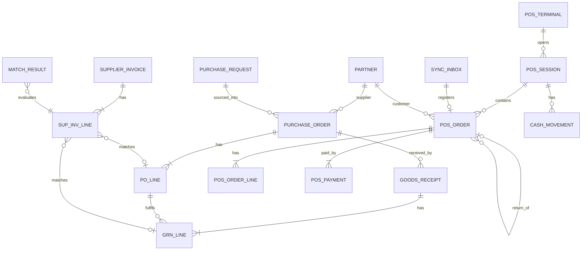

# Database Schema

**Version:** 0.1 — Draft · PostgreSQL 16+ · **Date:** 2026-11-05

Conventions
- PK `id uuid` (UUIDv7, generated by app/client). Human numbers in separate `number` columns.
- Every scoped table has `tenant_id`, and `company_id` (+ `branch_id` where relevant). Composite FKs include `company_id`.
- Audit columns: `created_at timestamptz`, `created_by uuid`, `updated_at`, `updated_by`, `version int` (optimistic lock). Immutable tables have no `updated_*`.
- Money `NUMERIC(19,4)`, qty `NUMERIC(19,6)`, unit cost `NUMERIC(19,6)`, rates `NUMERIC(9,6)`.
- Bilingual text: `name_ar text NOT NULL`, `name_en text`, plus generated `search_norm text` (Arabic-normalized lowercase).
- Module table prefixes: `core_`, `cat_`, `prc_`, `inv_`, `acc_`, `pur_`, `sal_`, `pos_`, `hr_`, `wf_`, `rep_`. (Prefixes omitted in diagrams for readability.)
- Soft delete only on master data (`archived_at`); transactional data is never deleted.

---

## 1. Core / Organization ERD

```mermaid
erDiagram
  TENANT ||--o{ COMPANY : has
  COMPANY ||--o{ BRANCH : has
  BRANCH ||--o{ WAREHOUSE : has
  WAREHOUSE ||--o{ LOCATION : contains
  LOCATION ||--o{ LOCATION : parent_of
  BRANCH ||--o{ POS_TERMINAL : has
  POS_TERMINAL ||--|| DEVICE : bound_to
  COMPANY ||--o{ COST_CENTER : has
  TENANT ||--o{ USER_ACCOUNT : has
  USER_ACCOUNT ||--o{ ROLE_ASSIGNMENT : holds
  ROLE ||--o{ ROLE_ASSIGNMENT : granted_as
  ROLE ||--o{ ROLE_PERMISSION : includes
  PERMISSION ||--o{ ROLE_PERMISSION : in
  ROLE_ASSIGNMENT }o--o| COMPANY : scope_company
  ROLE_ASSIGNMENT }o--o| BRANCH : scope_branch
  ROLE_ASSIGNMENT }o--o| WAREHOUSE : scope_warehouse

  COMPANY { uuid id PK; text legal_name_ar; text tax_reg_no; char3 base_currency; text costing_method; date fiscal_year_start }
  BRANCH { uuid id PK; uuid company_id FK; text code; text timezone; text eta_branch_code; uuid default_price_list_id }
  WAREHOUSE { uuid id PK; uuid company_id; uuid branch_id FK; text code; text kind }
  LOCATION { uuid id PK; uuid company_id; uuid warehouse_id FK; uuid parent_id; text type; text path }
  ROLE_ASSIGNMENT { uuid user_id; uuid role_id; text scope_type; uuid scope_id; date valid_to }
```

## 2. Product & Inventory Data Model

```mermaid
erDiagram
  PRODUCT ||--|{ PRODUCT_VARIANT : has
  PRODUCT }o--|| CATEGORY : in
  CATEGORY ||--o{ CATEGORY : parent_of
  PRODUCT }o--o| BRAND : of
  PRODUCT_VARIANT ||--o{ BARCODE : identified_by
  PRODUCT_VARIANT ||--o{ VARIANT_ATTRIBUTE_VALUE : has
  ATTRIBUTE ||--o{ ATTRIBUTE_VALUE : has
  ATTRIBUTE_VALUE ||--o{ VARIANT_ATTRIBUTE_VALUE : used_in
  PRODUCT }o--|| UOM : stock_uom
  UOM }o--|| UOM_CATEGORY : in
  PRODUCT_VARIANT ||--o{ SUPPLIER_PRODUCT : sourced_as
  PARTNER ||--o{ SUPPLIER_PRODUCT : supplies
  PRODUCT_VARIANT ||--o{ BRANCH_ASSORTMENT : listed_in
  BRANCH ||--o{ BRANCH_ASSORTMENT : lists
  PRICE_LIST ||--o{ PRICE_LIST_ITEM : contains
  PRODUCT_VARIANT ||--o{ PRICE_LIST_ITEM : priced
  PRODUCT_VARIANT ||--o{ STOCK_QUANT : stocked
  LOCATION ||--o{ STOCK_QUANT : holds
  LOT ||--o{ STOCK_QUANT : of_lot
  PRODUCT_VARIANT ||--o{ LOT : has
  PRODUCT_VARIANT ||--o{ STOCK_MOVE : moved
  LOCATION ||--o{ STOCK_MOVE : from_to
  STOCK_MOVE ||--o{ STOCK_MOVE_LOT : detail
  STOCK_MOVE ||--o{ VALUATION_LAYER : values
  PRODUCT_VARIANT ||--o{ PRODUCT_COST : costed
  STOCK_DOCUMENT ||--|{ STOCK_MOVE : groups

  PRODUCT { uuid id PK; text name_ar; text name_en; uuid category_id; uuid brand_id; uuid stock_uom_id; uuid tax_class_id; text tracking; text status; uuid merged_into_id }
  PRODUCT_VARIANT { uuid id PK; uuid product_id; text sku UK; text status; numeric weight; uuid merged_into_id }
  BARCODE { uuid id PK; uuid variant_id; text code; text symbology; uuid uom_id; numeric pack_qty; bool is_primary; text status }
  BRANCH_ASSORTMENT { uuid branch_id PK; uuid variant_id PK; bool sellable; bool purchasable; numeric reorder_point; numeric min_qty; numeric max_qty }
  PRICE_LIST_ITEM { uuid id PK; uuid price_list_id; uuid variant_id; uuid uom_id; numeric price; numeric min_qty; timestamptz valid_from; timestamptz valid_to }
  STOCK_QUANT { uuid location_id PK; uuid variant_id PK; uuid lot_id PK; uuid owner_id PK; numeric qty_on_hand; numeric qty_reserved; int version }
  STOCK_MOVE { uuid id PK; timestamptz moved_at PK; uuid variant_id; uuid from_location_id; uuid to_location_id; numeric qty; uuid uom_id; numeric qty_stock_uom; numeric unit_cost; text move_type; text ref_doc_type; uuid ref_doc_id; text state; uuid user_id; uuid branch_id }
  VALUATION_LAYER { uuid id PK; uuid company_id; uuid variant_id; uuid stock_move_id; numeric qty; numeric unit_cost; numeric value; numeric remaining_qty; numeric remaining_value }
  PRODUCT_COST { uuid company_id PK; uuid variant_id PK; numeric avg_cost; numeric qty_valued; numeric value_total; int version }
```

### 2.1 Core DDL (normative excerpt)

```sql
-- Arabic normalization used for search_norm & similar-name detection
CREATE FUNCTION rc_norm_ar(t text) RETURNS text IMMUTABLE LANGUAGE sql AS $$
  SELECT lower(
    regexp_replace(
      translate(coalesce(t,''), 'أإآٱىةؤئـ', 'اااايهوي'),   -- alef variants→ا, ى→ي, ة→ه, ؤ→و, ئ→ي, tatweel removed
      '[ً-ْ]', '', 'g'))                        -- strip harakat
$$;

CREATE TABLE cat_product (
  id              uuid PRIMARY KEY,
  tenant_id       uuid NOT NULL,
  name_ar         text NOT NULL,
  name_en         text,
  search_norm     text GENERATED ALWAYS AS (rc_norm_ar(name_ar) || ' ' || lower(coalesce(name_en,''))) STORED,
  category_id     uuid NOT NULL REFERENCES cat_category(id),
  brand_id        uuid REFERENCES cat_brand(id),
  stock_uom_id    uuid NOT NULL REFERENCES cat_uom(id),
  tax_class_id    uuid NOT NULL REFERENCES tax_class(id),
  tracking        text NOT NULL DEFAULT 'none' CHECK (tracking IN ('none','lot','serial')),
  is_weighted     boolean NOT NULL DEFAULT false,
  status          text NOT NULL DEFAULT 'draft' CHECK (status IN ('draft','active','discontinued','archived')),
  merged_into_id  uuid REFERENCES cat_product(id),
  created_at timestamptz NOT NULL DEFAULT now(), created_by uuid NOT NULL,
  updated_at timestamptz NOT NULL DEFAULT now(), updated_by uuid NOT NULL,
  version int NOT NULL DEFAULT 1
);
CREATE INDEX cat_product_trgm ON cat_product USING gin (search_norm gin_trgm_ops);

CREATE TABLE cat_variant (
  id uuid PRIMARY KEY, tenant_id uuid NOT NULL,
  product_id uuid NOT NULL REFERENCES cat_product(id),
  sku text NOT NULL,
  status text NOT NULL DEFAULT 'active',
  merged_into_id uuid REFERENCES cat_variant(id),
  -- audit cols …
  CONSTRAINT cat_variant_sku_uk UNIQUE (tenant_id, sku)
);

CREATE TABLE cat_barcode (
  id uuid PRIMARY KEY, tenant_id uuid NOT NULL,
  variant_id uuid NOT NULL REFERENCES cat_variant(id),
  code text NOT NULL,
  symbology text NOT NULL,              -- ean13, ean8, upca, code128, internal
  uom_id uuid REFERENCES cat_uom(id),   -- barcode of a carton
  pack_qty numeric(19,6) NOT NULL DEFAULT 1 CHECK (pack_qty > 0),
  is_primary boolean NOT NULL DEFAULT false,
  status text NOT NULL DEFAULT 'active' CHECK (status IN ('active','alias','retired'))
);
-- Duplicate barcode prevention: only one ACTIVE/ALIAS owner per code
CREATE UNIQUE INDEX cat_barcode_code_live_uk ON cat_barcode (tenant_id, code) WHERE status <> 'retired';
CREATE UNIQUE INDEX cat_barcode_one_primary ON cat_barcode (variant_id) WHERE is_primary;

CREATE TABLE cat_branch_assortment (
  company_id uuid NOT NULL, branch_id uuid NOT NULL, variant_id uuid NOT NULL REFERENCES cat_variant(id),
  sellable boolean NOT NULL DEFAULT true, purchasable boolean NOT NULL DEFAULT true,
  reorder_point numeric(19,6), min_qty numeric(19,6), max_qty numeric(19,6),
  PRIMARY KEY (branch_id, variant_id),
  FOREIGN KEY (company_id, branch_id) REFERENCES core_branch(company_id, id),
  CHECK (min_qty IS NULL OR max_qty IS NULL OR min_qty <= max_qty)
);

CREATE TABLE prc_price_list_item (
  id uuid PRIMARY KEY, price_list_id uuid NOT NULL REFERENCES prc_price_list(id),
  variant_id uuid NOT NULL REFERENCES cat_variant(id), uom_id uuid NOT NULL,
  price numeric(19,4) NOT NULL CHECK (price >= 0), min_qty numeric(19,6) NOT NULL DEFAULT 1,
  valid_from timestamptz NOT NULL, valid_to timestamptz,
  EXCLUDE USING gist (price_list_id WITH =, variant_id WITH =, uom_id WITH =, min_qty WITH =,
                      tstzrange(valid_from, valid_to) WITH &&)   -- no overlapping validity
);

-- Balances (mutable, row-locked). owner_id = NULL for own stock, supplier id for consignment.
CREATE TABLE inv_stock_quant (
  company_id uuid NOT NULL, location_id uuid NOT NULL, variant_id uuid NOT NULL,
  lot_id uuid NOT NULL DEFAULT '00000000-0000-0000-0000-000000000000',
  owner_id uuid NOT NULL DEFAULT '00000000-0000-0000-0000-000000000000',
  qty_on_hand numeric(19,6) NOT NULL DEFAULT 0,
  qty_reserved numeric(19,6) NOT NULL DEFAULT 0 CHECK (qty_reserved >= 0),
  version int NOT NULL DEFAULT 1,
  PRIMARY KEY (location_id, variant_id, lot_id, owner_id)
);
CREATE INDEX inv_quant_variant ON inv_stock_quant (variant_id, location_id);

-- Immutable movement ledger, monthly partitions
CREATE TABLE inv_stock_move (
  id uuid NOT NULL, moved_at timestamptz NOT NULL,
  company_id uuid NOT NULL, branch_id uuid NOT NULL,
  variant_id uuid NOT NULL,
  from_location_id uuid NOT NULL, to_location_id uuid NOT NULL,
  lot_id uuid, serial_no text, owner_id uuid,
  qty numeric(19,6) NOT NULL CHECK (qty > 0),
  uom_id uuid NOT NULL, qty_stock_uom numeric(19,6) NOT NULL CHECK (qty_stock_uom > 0),
  unit_cost numeric(19,6),                -- filled by valuation
  move_type text NOT NULL,                -- receipt, sale, sale_return, purchase_return, transfer_out, transfer_in, adjustment_gain, adjustment_loss, scrap, count_gain, count_loss
  reason_code text,
  ref_doc_type text NOT NULL, ref_doc_id uuid NOT NULL, ref_line_id uuid,
  approval_state text NOT NULL DEFAULT 'not_required',
  user_id uuid NOT NULL, device_id uuid,
  reversal_of_id uuid,
  created_at timestamptz NOT NULL DEFAULT now(),
  PRIMARY KEY (id, moved_at),
  CHECK (from_location_id <> to_location_id)
) PARTITION BY RANGE (moved_at);
CREATE INDEX ON inv_stock_move (variant_id, moved_at);
CREATE INDEX ON inv_stock_move (ref_doc_type, ref_doc_id);
CREATE INDEX ON inv_stock_move USING brin (moved_at);
-- Immutability
CREATE TRIGGER inv_stock_move_immutable BEFORE UPDATE OR DELETE ON inv_stock_move
  FOR EACH ROW EXECUTE FUNCTION rc_forbid_mutation();
```

## 3. Accounting Data Model

```mermaid
erDiagram
  COMPANY ||--o{ ACCOUNT : owns
  ACCOUNT ||--o{ ACCOUNT : parent_of
  COMPANY ||--o{ FISCAL_YEAR : has
  FISCAL_YEAR ||--|{ FISCAL_PERIOD : has
  COMPANY ||--o{ JOURNAL : has
  JOURNAL ||--o{ JOURNAL_ENTRY : contains
  JOURNAL_ENTRY ||--|{ JOURNAL_LINE : has
  ACCOUNT ||--o{ JOURNAL_LINE : posted_to
  JOURNAL_ENTRY |o--o| JOURNAL_ENTRY : reverses
  JOURNAL_LINE }o--o| PARTNER : partner
  JOURNAL_LINE }o--o| COST_CENTER : dimension
  JOURNAL_LINE }o--o| BRANCH : dimension
  JOURNAL_LINE }o--o| TAX_RATE : tax
  POSTING_RULE ||--|{ POSTING_RULE_LINE : defines
  ACCOUNT_MAPPING }o--|| ACCOUNT : maps_to
  JOURNAL_LINE ||--o{ RECONCILE_ITEM : matched_in
  RECONCILE_GROUP ||--|{ RECONCILE_ITEM : groups
  ACCOUNT ||--o{ ACCOUNT_BALANCE_PERIOD : totals

  ACCOUNT { uuid id PK; uuid company_id; text code; text name_ar; text type; text normal_side; bool is_postable; bool reconcilable; bool intercompany }
  JOURNAL_ENTRY { uuid id PK; date posting_date PK; uuid company_id; uuid journal_id; text number; text state; text source_type; uuid source_id; uuid source_event_id UK; uuid reversal_of_id; numeric total_debit; numeric total_credit; uuid posted_by; timestamptz posted_at }
  JOURNAL_LINE { uuid id PK; date posting_date PK; uuid entry_id; uuid account_id; numeric debit; numeric credit; char3 currency; numeric amount_currency; numeric fx_rate; uuid partner_id; uuid branch_id; uuid cost_center_id; uuid tax_rate_id; numeric tax_base }
  FISCAL_PERIOD { uuid id PK; uuid company_id; date start_date; date end_date; text state }
  ACCOUNT_BALANCE_PERIOD { uuid company_id PK; uuid account_id PK; uuid branch_id PK; uuid cost_center_id PK; uuid period_id PK; numeric debit; numeric credit }
```

### 3.1 Accounting DDL (normative excerpt)

```sql
CREATE TABLE acc_account (
  id uuid PRIMARY KEY, company_id uuid NOT NULL, code text NOT NULL,
  name_ar text NOT NULL, name_en text,
  type text NOT NULL CHECK (type IN ('asset','liability','equity','income','expense')),
  subtype text,  -- cash, bank, receivable, payable, inventory, cogs, tax_output, tax_input, clearing, contra_revenue …
  parent_id uuid REFERENCES acc_account(id),
  is_postable boolean NOT NULL DEFAULT true,
  reconcilable boolean NOT NULL DEFAULT false,
  currency char(3),
  archived_at timestamptz,
  UNIQUE (company_id, code), UNIQUE (company_id, id)
);

CREATE TABLE acc_journal_entry (
  id uuid NOT NULL, posting_date date NOT NULL,
  company_id uuid NOT NULL, journal_id uuid NOT NULL,
  number text,                                   -- assigned at posting, gapless per journal/year
  state text NOT NULL CHECK (state IN ('draft','posted','reversed')),
  source_type text NOT NULL, source_id uuid,
  source_event_id uuid,                          -- idempotency for auto-posting
  posting_rule_id uuid, posting_rule_version int,
  reversal_of_id uuid, reversal_reason text,
  memo text,
  total_debit numeric(19,4) NOT NULL DEFAULT 0, total_credit numeric(19,4) NOT NULL DEFAULT 0,
  posted_by uuid, posted_at timestamptz, approved_by uuid,
  PRIMARY KEY (id, posting_date),
  CHECK (state <> 'posted' OR (total_debit = total_credit AND total_debit > 0))
) PARTITION BY RANGE (posting_date);
-- Global idempotency for auto-posting (non-partitioned registry, same reason as sync_inbox)
CREATE TABLE acc_posting_registry (
  source_event_id uuid PRIMARY KEY, entry_id uuid NOT NULL, posting_date date NOT NULL, created_at timestamptz NOT NULL DEFAULT now()
);

CREATE TABLE acc_journal_line (
  id uuid NOT NULL, posting_date date NOT NULL, entry_id uuid NOT NULL,
  company_id uuid NOT NULL, account_id uuid NOT NULL,
  debit numeric(19,4) NOT NULL DEFAULT 0 CHECK (debit >= 0),
  credit numeric(19,4) NOT NULL DEFAULT 0 CHECK (credit >= 0),
  currency char(3) NOT NULL, amount_currency numeric(19,4), fx_rate numeric(19,8),
  partner_id uuid, branch_id uuid, cost_center_id uuid, profit_center_id uuid,
  tax_rate_id uuid, tax_base numeric(19,4),
  product_variant_id uuid, quantity numeric(19,6),
  due_date date, label text,
  PRIMARY KEY (id, posting_date),
  CHECK ((debit = 0) <> (credit = 0)),            -- exactly one side non-zero
  FOREIGN KEY (entry_id, posting_date) REFERENCES acc_journal_entry(id, posting_date),
  FOREIGN KEY (company_id, account_id) REFERENCES acc_account(company_id, id)
) PARTITION BY RANGE (posting_date);

-- Balance enforcement at COMMIT (deferred), recomputed from lines, not trusted from header
CREATE CONSTRAINT TRIGGER acc_entry_balanced AFTER INSERT OR UPDATE ON acc_journal_entry
  DEFERRABLE INITIALLY DEFERRED FOR EACH ROW EXECUTE FUNCTION acc_check_entry_balanced();
-- Posted entries & their lines are immutable (only state posted→reversed allowed, via function)
CREATE TRIGGER acc_line_immutable BEFORE UPDATE OR DELETE ON acc_journal_line
  FOR EACH ROW EXECUTE FUNCTION acc_forbid_if_posted();
-- Period lock enforced in DB too
CREATE TRIGGER acc_entry_period_open BEFORE INSERT OR UPDATE ON acc_journal_entry
  FOR EACH ROW EXECUTE FUNCTION acc_check_period_open();
```

## 4. Purchasing, Sales & POS (summary ERD)



Key POS tables:
```sql
CREATE TABLE pos_sync_inbox (           -- global idempotency registry (not partitioned)
  client_id uuid PRIMARY KEY,            -- UUIDv7 generated on terminal
  device_id uuid NOT NULL, item_type text NOT NULL, device_seq bigint NOT NULL,
  payload_hash bytea NOT NULL, status text NOT NULL, server_ref uuid,
  received_at timestamptz NOT NULL DEFAULT now(), applied_at timestamptz, error jsonb,
  UNIQUE (device_id, device_seq)
);

CREATE TABLE pos_order (
  id uuid NOT NULL, business_date date NOT NULL,
  company_id uuid NOT NULL, branch_id uuid NOT NULL, terminal_id uuid NOT NULL, session_id uuid NOT NULL,
  receipt_no text NOT NULL,              -- <branch>-<terminal>-<seq>, generated offline
  kind text NOT NULL CHECK (kind IN ('sale','return','exchange')),
  return_of_id uuid, customer_id uuid, cashier_id uuid NOT NULL,
  sold_at timestamptz NOT NULL, synced_at timestamptz NOT NULL,
  subtotal numeric(19,4) NOT NULL, discount_total numeric(19,4) NOT NULL,
  tax_total numeric(19,4) NOT NULL, grand_total numeric(19,4) NOT NULL,
  rounding numeric(19,4) NOT NULL DEFAULT 0,
  calc_engine_version text NOT NULL, server_recalc_delta numeric(19,4),
  offline boolean NOT NULL, eta_status text, eta_uuid text,
  PRIMARY KEY (id, business_date),
  UNIQUE (terminal_id, receipt_no, business_date)
) PARTITION BY RANGE (business_date);
```

## 5. Cross-cutting tables
| Table | Purpose |
|---|---|
| `core_audit_log` (partitioned) | who/when/what/before/after/ip/device/request_id; append-only; hash-chained per day (`prev_hash`) for tamper evidence |
| `core_outbox_event` | transactional outbox (id, aggregate, type, payload, created_at, published_at) |
| `core_processed_event` | consumer idempotency `(consumer, event_id)` PK |
| `core_change_log` | POS/mobile pull feed `(tenant_id, version bigserial, stream, entity_id, op)` |
| `core_number_sequence` | numbering with `FOR UPDATE` row (gapless where legally required, else gap-tolerant) |
| `wf_approval_request` / `wf_approval_step` | generic approvals for any document |
| `core_job` | async job tracking (imports, exports, bulk edits) with result files |

## 6. Partitioning Plan
| Table | Key | Granularity | Retention online |
|---|---|---|---|
| inv_stock_move | moved_at | month | 10 y (old partitions on cheaper tablespace) |
| acc_journal_entry / line | posting_date | month | 10 y |
| pos_order / line / payment | business_date | month | 5 y online, archive after |
| core_audit_log | created_at | month | 24 m online, then object storage (Parquet) |
| core_outbox_event | created_at | week | 30 d after published |

Managed by `pg_partman` (pre-create 3 months ahead). Default partition exists and is monitored (should stay empty).

## 7. Indexing principles
- Composite indexes lead with the scope column most used in filters (`company_id`/`branch_id`) then the selective key.
- Partial indexes for live states (`WHERE status='active'`, `WHERE state='draft'`).
- BRIN on time columns of append-only partitions; B-tree for lookups.
- Every FK has a supporting index (checked in CI by a catalog query).
- Index additions on large tables: `CREATE INDEX CONCURRENTLY` in separate non-transactional migrations.

## 8. Migration policy
- Expand → migrate → contract (never rename/drop in the same release as code change).
- Down migrations provided for schema-only changes; data migrations are forward-only with tested backups.
- Every migration tested against a production-size snapshot in staging (timing recorded) before release.
